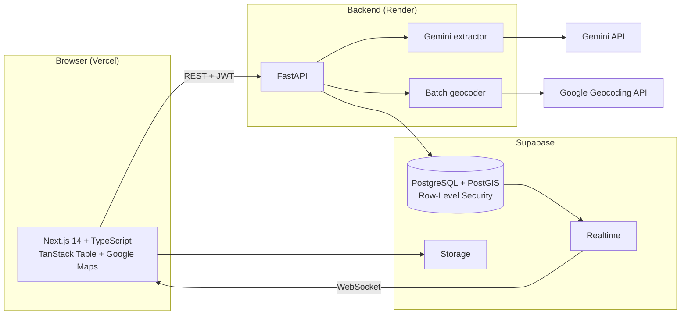

# PropSync

**A spatial-first property inventory platform for real estate agencies. It turns messy WhatsApp listings into structured records and keeps a spreadsheet-style grid and an interactive map in sync.**

[](https://nextjs.org/)
[](https://fastapi.tiangolo.com/)
[](https://postgis.net/)
[](https://ai.google.dev/)
[](https://supabase.com/)

**Live demo:** [https://propsync-test.vercel.app](https://propsync-test.vercel.app)

PropSync demo: grid and map syncing
<!-- Replace with a 10-15 second GIF: click a row, the map centers on the pin; draw a parcel polygon. Add 1-2 static screenshots below. -->


---

## The Problem

Land and commercial property agents juggle WhatsApp messages from owners, spreadsheets of listings, PDF land documents, and map screenshots. Details get lost, the data lives in several places, and nobody sees where a listing sits relative to its surroundings.

## What PropSync Does

1. **Turns WhatsApp messages into listings.** Paste an owner's informal message and Gemini extracts a structured draft that an agent reviews and edits before it is saved.
2. **Keeps grid and map in sync.** Click a row and the map centers on it; click a pin and the grid scrolls to the record. Changes from teammates appear in real time.
3. **Supports land parcels.** Agents draw parcel boundaries on a satellite map, stored as PostGIS polygons.
4. **Organizes documents.** Drag files from a shared document vault onto property records.
5. **Separates each agency's data.** Every agency (organization) only sees its own records.

---

## Architecture



---

## Key Engineering Decisions

### 1. Structured LLM extraction with human review
- **Problem:** Owners send listings as informal text with mixed currencies, abbreviations, and missing fields.
- **Approach:** Gemini is called with a Pydantic JSON schema (`response_schema=ExtractedListing`), so the output always matches the expected structure.
- **Safeguard:** A valid schema does not guarantee correct values, so every extraction lands in an editable draft that an agent confirms before it is written to the database.

### 2. Grid and map synchronization
- TanStack Table v8 and Google Maps (`@react-google-maps/api`) share selection state, so selecting on either side updates the other.
- Supabase Realtime (`postgres_changes`) pushes updates to open sessions, so users do not need to refresh.

### 3. Geospatial data with PostGIS
- SQLAlchemy 2.0 and GeoAlchemy2 model both points (`geometry(Point, 4326)`) and parcel boundaries (`geometry(Polygon, 4326)`), with GIST spatial indexes.
- Agents draw boundaries directly on the map; they are saved as WKT/GeoJSON.
- Imported addresses without coordinates fall back to the Google Geocoding API.

### 4. Document vault
- Unassigned files can be dragged onto property records using the native HTML5 Drag and Drop API, with optimistic UI updates and rollback on error.
- Files are stored in Supabase Storage and previewed in a brochure grid.

### 5. Multi-tenant isolation
- **Auth:** The backend verifies Supabase JWTs against the public JWKS endpoint (ES256), so no shared secret is needed.
- **Isolation:** Row-Level Security policies in Postgres, plus `org_id` scoping enforced in FastAPI, keep each agency's data separate.

### 6. CSV import
- Bulk import maps common column aliases automatically (e.g. `asking_psf`, `tenure`, `mukim`, `lot_no`), deduplicates rows, and geocodes missing coordinates.

---

## Tech Stack

| Area | Technology |
| :--- | :--- |
| Frontend | Next.js 14 (App Router), React 18, TypeScript, Tailwind CSS, TanStack Table v8 |
| Maps | Google Maps JavaScript API, `@react-google-maps/api` |
| Backend | FastAPI, Pydantic v2, Uvicorn, Python 3.12 |
| Database | PostgreSQL 15+ with PostGIS, SQLAlchemy 2.0, GeoAlchemy2 |
| AI | Google Gemini (`google-genai` SDK), structured JSON output |
| Auth, Realtime, Storage | Supabase (Auth, RLS, Realtime, Storage) |
| Deployment | Vercel (frontend), Render (backend) |

---

## Repository Structure

```
propsync/
├── backend/
│   ├── app/
│   │   ├── routers/        # extract, properties, csv_import
│   │   ├── services/       # Gemini extraction, geocoding
│   │   ├── models.py       # SQLAlchemy + GeoAlchemy2 models
│   │   ├── schemas.py      # Pydantic request/response schemas
│   │   ├── deps.py         # JWKS verification, tenant resolution
│   │   └── config.py       # pydantic-settings configuration
│   ├── migrations/         # PostGIS schema + RLS policies
│   └── requirements.txt
├── frontend/
│   ├── app/                # App Router pages (dashboard, properties, vault, settings, login)
│   ├── components/         # PropertyGrid, PropertyMap, Workspace, Vault
│   └── lib/                # API client, auth, Supabase client, types
├── vercel.json
└── README.md
```

---

## Getting Started

### Prerequisites
- Node.js 18+ and npm
- Python 3.12+
- A Supabase project (or PostgreSQL with PostGIS enabled)
- A Google Gemini API key ([Google AI Studio](https://ai.google.dev/))
- A Google Maps API key ([Google Cloud Console](https://console.cloud.google.com/))

### 1. Database
Run `backend/migrations/001_init.sql` in the Supabase SQL editor. It enables PostGIS, creates the tables, and turns on Row-Level Security.

### 2. Backend

```bash
cd backend
python -m venv venv
source venv/bin/activate        # Windows: venv\Scripts\activate
pip install -r requirements.txt
cp .env.example .env            # fill in your own values
uvicorn app.main:app --reload --port 8000
```

Required variables: `DATABASE_URL`, `SUPABASE_URL`, `GEMINI_API_KEY`, `GOOGLE_MAPS_API_KEY`.
API docs: `http://localhost:8000/docs`

### 3. Frontend

```bash
cd frontend
npm install
cp .env.local.example .env.local   # fill in your own values
npm run dev
```

Required variables: `NEXT_PUBLIC_API_BASE_URL`, `NEXT_PUBLIC_SUPABASE_URL`, `NEXT_PUBLIC_SUPABASE_ANON_KEY`, `NEXT_PUBLIC_GOOGLE_MAPS_API_KEY`.
Open `http://localhost:3000`.

> Never commit `.env` files. Use `.env.example` with placeholder values only.

---

## Limitations and Roadmap

- **Testing:** [Describe your current test coverage honestly.] Planned: automated tests for the extraction schema and for tenant isolation (confirming one org cannot read another's records).
- **Extraction accuracy:** Output is schema-valid but not always correct, which is why human review is required. Planned: an evaluation set of real messages to measure field-level accuracy.
- **Offline and mobile:** The grid and map are built for desktop use; the mobile layout is basic.
- **Planned:** role-based permissions within an agency, an audit log of edits, and export to PDF brochures.

---

## License

Copyright (c) 2026 Siaw Boon Ken. All rights reserved.

This code is published for viewing and portfolio purposes only. No permission is granted to copy, modify, distribute, or use it commercially without written permission.
